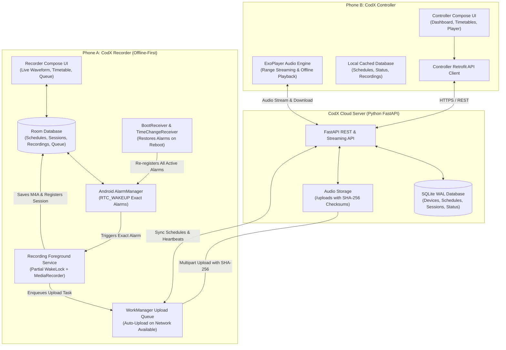

# CodX Recorder & CodX Controller — Remotely Synchronized Recording System

An offline-first, remotely synchronized recording system spanning two independent Android applications and a Python FastAPI cloud synchronization server.

> **Core System Guarantee**: Recording on Phone A (**CodX Recorder**) **never** depends on an active internet connection once a schedule has been saved. Even if cellular data and Wi-Fi are switched off, the controller phone is unavailable, or Phone A is rebooted, all scheduled recording timetables execute reliably on hardware alarms.

---

## 1. System Architecture



---

## 2. Project Directory Structure

```
codx-project/
├── TERMS_AND_CONDITIONS.md             # Complete legal Terms of Service for Play Store approval
├── PRIVACY_POLICY.md                   # GDPR, CCPA & Google Play User Data compliant policy
├── PLAY_STORE_COMPLIANCE.md            # Exact Data Safety questionnaire answers & review guide
├── README.md                           # Master setup and architectural overview
├── IMPLEMENTATION_NOTES.md             # In-depth technical breakdown and hardening guide
├── server/                             # Python FastAPI Cloud Synchronization Server
│   ├── main.py                         # FastAPI application entry point & CORS
│   ├── database.py                     # SQLite WAL-mode engine and session manager
│   ├── models.py                       # SQLAlchemy ORM models (Users, Devices, Schedules, Sessions)
│   ├── schemas.py                      # Pydantic request/response schemas
│   ├── requirements.txt                # Python dependencies
│   ├── test_server.py                  # 14 end-to-end integration & auth tests
│   └── routers/
│       ├── auth.py                     # Google login (Firebase API), account deletion & pairing
│       ├── status.py                   # Heartbeat and hardware telemetry
│       ├── schedules.py                # Bi-directional timetable sync
│       ├── recordings.py               # Resumable upload, Range streaming, download
│       └── sessions.py                 # Recording session audit logs
├── recorder/                           # Phone A: CodX Recorder Android App
│   ├── build.gradle.kts                # Project Gradle build config
│   ├── settings.gradle.kts             # Gradle settings
│   └── app/
│       ├── build.gradle.kts            # App dependencies (Room, WorkManager, Compose)
│       └── src/main/
│           ├── AndroidManifest.xml     # Permissions, foreground services, receivers
│           └── java/com/codx/recorder/
│               ├── CodXRecorderApp.kt  # Channel init & periodic sync scheduler
│               ├── data/
│               │   ├── local/          # Room DB (Devices, Schedules, Sessions, Recordings, Queue)
│               │   ├── remote/         # Retrofit API service & DTOs
│               │   └── repository/     # RecorderRepository & SyncRepository
│               ├── recording/          # RecordingService, AudioRecorderManager, FileValidator
│               ├── scheduler/          # AlarmScheduler, AlarmReceiver, BootReceiver, TimeChangeReceiver
│               ├── sync/               # UploadWorker, DeviceHealthMonitor
│               └── ui/                 # Jetpack Compose UI (Dashboard, Waveform, Timetable, History)
└── controller/                         # Phone B: CodX Controller Android App
    ├── build.gradle.kts                # Project Gradle build config
    ├── settings.gradle.kts             # Gradle settings
    └── app/
        ├── build.gradle.kts            # App dependencies (Media3 ExoPlayer, Compose, Room)
        └── src/main/
            ├── AndroidManifest.xml     # Network permissions
            └── java/com/codx/controller/
                ├── CodXControllerApp.kt
                ├── data/               # Local cache, Retrofit client, ControllerRepository
                ├── playback/           # AudioPlayerManager (ExoPlayer streaming & scrubbing)
                └── ui/                 # Jetpack Compose UI (Remote Dashboard, Timetable Editor, Player Sheet)
```

---

## 3. Database Specification

Both phones and the cloud server utilize unified relational schemas matching the project specifications:

| Database Table | Purpose |
| :--- | :--- |
| **Devices** | Paired device identities, authentication tokens, 6-digit pairing codes (`CDX-XXXX`). |
| **Schedules** | Start and stop times (`HH:mm`), daily and weekly recurrence patterns, active toggles. |
| **RecordingSessions** | Individual recording executions, lifecycle states (`RECORDING`, `COMPLETED`, `INTERRUPTED`). |
| **Recordings** | Audio file metadata: unique UUID, file size, duration, SHA-256 checksum, local storage path. |
| **SyncQueue** | Pending uploads and telemetry updates managed by WorkManager with exponential backoff. |
| **DeviceStatus** | Battery percentage, charging state, available storage space, network connectivity, online status. |
| **SyncEvents** | Synchronization audit history for recovery and system monitoring. |

> **Deduplication Guarantee**: Every audio recording is assigned a unique UUID on Phone A before the microphone starts capturing. Reconnection attempts never create duplicate recordings on the server.

---

## 4. Setup and Execution Guide

### A. Cloud Server (FastAPI)

1. Open a terminal in `codx-project/server/`:
   ```powershell
   cd server
   ```
2. Create and activate a Python virtual environment:
   ```powershell
   python -m venv venv
   .\venv\Scripts\Activate.ps1
   ```
3. Install dependencies:
   ```powershell
   pip install -r requirements.txt
   ```
4. Run the automated integration test suite:
   ```powershell
   python test_server.py
   ```
5. Start the live cloud server:
   ```powershell
   uvicorn main:app --host 0.0.0.0 --port 8000 --reload
   ```
   * Interactive Swagger documentation is available at `http://localhost:8000/docs`.

---

### B. CodX Recorder (Phone A)

1. Open Android Studio and choose **Open an Existing Project** -> select `codx-project/recorder/`.
2. Allow Gradle sync to complete (requires Android SDK 34 / Java 17).
3. Connect Phone A (or run an Android Emulator).
4. Run the app (`Shift + F10`).
5. Grant Microphone and Notification permissions when prompted.
6. Under the **Pairing** tab:
   - Note the **Pairing Code** (e.g., `CDX-6852`).
   - If running on a physical phone, set the **Server URL** to your server's LAN IP (e.g. `http://192.168.1.50:8000/`). On an emulator, the default `http://10.0.2.2:8000/` connects directly to the host machine.

---

### C. CodX Controller (Phone B)

1. Open Android Studio -> select `codx-project/controller/`.
2. Allow Gradle sync to complete.
3. Connect Phone B (or run a second Android Emulator).
4. Run the app (`Shift + F10`).
5. In the **Pair** tab:
   - Enter the server URL.
   - Enter the 6-digit **Pairing Code** shown on Phone A (e.g., `CDX-6852`).
   - Tap **Pair Controller with Recorder**.
6. The Remote Dashboard will immediately reflect Phone A's battery percentage, charging state, free storage, and online status.

---

## 5. Offline-First Verification Procedure

To verify that Phone A records completely independently:

1. Open **CodX Controller** (Phone B) and create a schedule starting in 2 minutes.
2. In **CodX Recorder** (Phone A), tap **Sync Now** to download the timetable into Room DB.
3. **Turn off Wi-Fi and Cellular data** on Phone A (or enable Airplane Mode).
4. Turn off Phone B completely.
5. **Reboot Phone A**.
6. Observe that when the scheduled start time arrives:
   - `AlarmManager` fires via `BootReceiver`.
   - `RecordingService` starts with a partial WakeLock.
   - The microphone records audio even while the phone is offline and screen is locked.
7. Once recording finishes, the audio file is safely saved in local storage with SHA-256 verification.
8. Re-enable Wi-Fi on Phone A: `UploadWorker` detects network connectivity, uploads the audio file to the cloud server, and Phone B can stream and download the recording.
